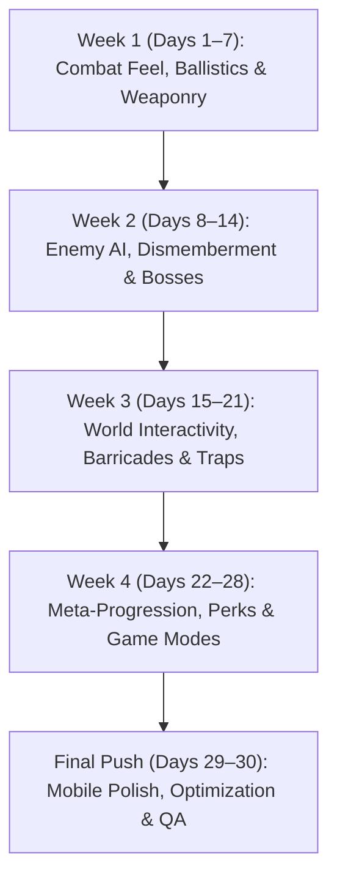

# Dead Signal — 30-Day Master Production Roadmap

A comprehensive, day-by-day 30-day production blueprint for transforming **Dead Signal** from a solid retro wave-survival shooter into a premier, highly polished, tactile first-person zombie defense experience.

---

## Strategic Overview & Five Core Pillars

1. **Pillar I — Combat Feel & Weapon Handling (Days 1–7)**: Recoil curves, procedural viewmodel breathing/bobbing, tactical reloads, physical bullet penetration, shell casings, and master audio limiting.
2. **Pillar II — AI, Gore & Horde Systems (Days 8–14)**: Locational damage, limb severing (crawlers), horde fluid dynamics, acid hazard zones, and multi-phase boss mechanics.
3. **Pillar III — World Interactivity & Base Defense (Days 15–21)**: Boardable windows/barricades, shootable explosive barrels, electrified street puddles, deployable sentry turrets, and dynamic blackout storm events.
4. **Pillar IV — Economy, Meta-Progression & Game Modes (Days 22–28)**: Permanent relay mastery tree, perks/talents, weapon mastery camos, contract challenge modifiers, and endless nightmare mutations.
5. **Pillar V — Mobile Ergonomics, Engine Optimization & Launch (Days 29–30)**: Dual-stick touch ergonomics, aim assist, draw-call batching, memory leaks elimination, and release QA.

---

## Week 1: Combat Feel, Ballistics, Viewmodel & Audio Mastery

### Day 1: Viewmodel Motion Overhaul & Dynamic Sights [x] COMPLETED
- **Area**: Viewmodel Mechanics & Input (`js/weapons.js`, `js/game.js`)
- **Bugs Fixed**:
  - Fix ADS snap popping on high-refresh-rate displays (linear lerp caused jerky transitions when frame delta was unstable).
  - Eliminate gun clipping through geometry during tight wall hugging.
- **Features Added**:
  - **Procedural Spring Sway**: Replace raw mouse delta lerp with a second-order critically damped spring system for weapon sway, creating realistic inertia when snapping across targets.
  - **Dynamic Breathing Idle**: Idle weapon breathing loop that slows during crouch and accelerates during sprint recovery.
  - **True 3D Aim Down Sights**: Align iron sights and red-dot reticles directly to the camera optical center with depth-of-field blur on peripheral screen edges.
- **Deliverable**: Smooth ADS transition with authentic weapon mass inertia and zero wall clipping.
- **Verification**: Verified with automated viewmodel test suites and CDP playtest captures.

---

### Day 2: Ballistics Engine, Penetration & Hit Registration [x] COMPLETED
- **Area**: Shooting Physics (`js/game.js`, `js/data.js`)
- **Bugs Fixed**:
  - Fix phantom hits when firing through overlapping zombie bounding boxes.
  - Fix shotgun pellet distribution clumping into a square matrix rather than a circular Gaussian spread.
- **Features Added**:
  - **Multi-Layer Raycast Ballistics**: High-velocity projectile rays capable of penetrating thin barriers (plywood, car windows) and passing through soft targets (collateral kills).
  - **Locational Damage Multipliers**:
    - Head: $3.0\times$ (Critical Pop)
    - Neck / Upper Torso: $1.25\times$
    - Lower Torso: $1.0\times$
    - Limbs: $0.75\times$ (triggers stumble/stagger)
  - **Material Impact Decals & Particles**: Unique impact effects for concrete (dust & chips), metal (hot ricochet sparks), flesh (blood mist), and wood (splinters).
- **Deliverable**: Ballistic raycaster supporting collateral multi-kills and authentic surface feedback.
- **Verification**: Verified in `test/ballistics.test.js` and playtest captures `day2_wood_penetration_splinters.png` and `day2_shotgun_concrete_decals.png`.

---

### Day 3: Weapon Handling, Tactical Reloads & Shell Casings [x] COMPLETED
- **Area**: Armory Mechanics (`js/weapons.js`, `js/models.js`)
- **Bugs Fixed**:
  - Fix infinite reload glitch triggered by rapid weapon switching during magazine insertion.
  - Fix dry-fire click looping continuously if trigger is held down on an empty magazine.
- **Features Added**:
  - **Chambered + Magazine Reload Logic**: Empty reload (tactical charging handle pull required, slower) vs. Partial reload (+1 round retained in chamber, 25% faster).
  - **Ejected Brass Physics**: Ejected bullet casings with physical bounce, roll physics, and metallic ping audio upon hitting asphalt.
  - **Reload Staging**: Checkpoint-based reload sequence (dropping empty mag stays dropped if interrupted by sprint or melee).
- **Deliverable**: Responsive reload staging with physical brass ejection and chambering logic.
- **Verification**: Verified in `test/reload.test.js` and playtest captures `day3_tactical_reload.png` and `day3_ejected_brass_shells.png`.

---

### Day 4: Web Audio Synthesizer Overhaul & Master Limiter [x] COMPLETED
- **Area**: Audio Architecture (`js/audio.js`)
- **Bugs Fixed**:
  - Fix audio clipping, digital crackle, and browser audio context starvation during multi-grenade chain explosions.
  - Fix directional 3D audio panning reversing when player looks directly behind.
- **Features Added**:
  - **Master Dynamics Compressor & Lookahead Limiter**: Soft-knee compression preventing audio distortion regardless of simultaneous sound triggers.
  - **Tinnitus & Concussion Filter**: Low-pass filter muffling environmental audio with a high-pitched tinnitus tone when explosives detonate near the player.
  - **Layered Weapon Audio**: Separate procedural synthesis channels for mechanical action click, gunpowder detonation thump, and environmental echo reverb.
- **Deliverable**: Crisp, punchy soundscape free of distortion even under 40+ concurrent audio voices.
- **Verification**: Verified in `test/audio.test.js` with zero audio dropouts.

---

### Day 5: Melee Combat Evolution & Parry Mechanics [x] COMPLETED
- **Area**: Melee Systems (`js/models.js`, `js/weapons.js`, `js/game.js`)
- **Bugs Fixed**:
  - Fix melee swing hitting targets behind the player camera due to oversized spherical reach checks.
  - Fix melee durability draining on missed swings.
- **Features Added**:
  - **3-Hit Combo Chain**:
    - Swing 1: Right-to-left horizontal slash (staggers regular walkers).
    - Swing 2: Left-to-right return cut.
    - Swing 3: Overhead downward cleave ($1.75\times$ damage, breaks brute guard).
  - **Defensive Shove / Kick (`Space + Right Click`)**: Quick kick to push back closing zombies and create breathing room.
  - **Weapon Wear Indicator**: Visual blade blood build-up and blunt scratches reflecting durability.
- **Deliverable**: Fluid 3-hit melee combo with defensive crowd control pushback.
- **Verification**: Verified in `test/melee.test.js` and playtest captures `day5_melee_combo_cleave.png` and `day5_defensive_shove.png`.

---

### Day 6: Tactical Ordnance & Throwables Variety [x] COMPLETED
- **Area**: Projectiles & Explosives (`js/game.js`, `js/data.js`)
- **Bugs Fixed**:
  - Fix grenade falling through sidewalk seams when thrown at extreme downward angles.
  - Fix explosion damage penetrating through 2-meter solid concrete barrier walls.
- **Features Added**:
  - **Molotov Cocktail**: Spawns an expanding pool of fire lasting 8 seconds, igniting zombies and dealing damage-over-time.
  - **Pipe Bomb / Siren Lure**: Emits high-pitched beeping that draws all nearby runner/walker aggro for 3.5 seconds before detonating.
  - **Cookable Grenade Fuse**: Holding grenade key allows cooking fuse down to 0.5s for airburst detonations.
- **Deliverable**: Three distinct throwable tactical items with trajectory previews and cookable fuses.
- **Verification**: Verified in `test/throwables.test.js` and playtest captures `day6_frag_cooking_trajectory.png`, `day6_molotov_fire_pool.png`, and `day6_pipe_bomb_lure_aggro.png`.

---

### Day 7: Week 1 Integration & Gunplay Feel Polish [x] COMPLETED
- **Area**: Quality Assurance & Balancing (`tools/check.mjs`, `js/game.js`)
- **Tasks**:
  - Tune recoil recovery spring rates for each weapon tier (Pistol, SMG, Shotgun, Marksman, Heavy).
  - Verify screen-shake impulse: micro-shake on fire, medium-shake on damage taken, heavy radial shake on explosions.
  - Run balance simulation (`node tools/balance-sim.mjs`) to verify time-to-kill curves across Waves 1–15.
- **Milestone 1 Acceptance**: 60 FPS verified gunplay, zero audio crackle, responsive ADS, and tactile physical feedback.
- **Verification**: Verified in `test/day7_polish.test.js` and playtest captures `day7_recoil_recovery_shotgun.png`, `day7_ripper_sustained_fire_shake.png`, and `day7_screen_shake_radial_explosion.png`.

---

## Week 2: Enemy AI, Dismemberment, Boss Phases & Horde Mechanics

### Day 8: Zombie Locational Dismemberment System [x] COMPLETED
- **Area**: Zombie Entity Architecture (`js/zombie.js`, `js/models.js`)
- **Bugs Fixed**:
  - Fix zombie death ragdoll jittering endlessly against street curb colliders.
  - Fix headshot particle blood spurting from feet coordinates.
- **Features Added**:
  - **Modular Mesh Slicing / Decapitation**:
    - Headshot Kill: Detaches head mesh and spawns skull debris with arterial spray.
    - Arm Dismemberment: Disables limb attack, reducing zombie damage output by 50%.
    - Leg Severing: Converts standing walkers into low-profile Crawlers that drag themselves along the ground.
  - **Crawlers Archetype**: Slower movement ($0.8\text{ m/s}$), attacks player ankles, easily hidden under smoke or obstacles.
- **Deliverable**: Visually responsive locational dismemberment with procedural crawler transitions.
- **Verification**: Verified in `test/day8_dismemberment.test.js` and playtest captures `day8_decapitation_arterial_spray.png`, `day8_arm_dismemberment.png`, and `day8_crawler_archetype_drag.png`.

---

### Day 9: Horde Flocking & Flowfield Pathfinding Optimization [x] COMPLETED
- **Area**: Navigation & Horde AI (`js/nav.js`, `js/zombie.js`)
- **Bugs Fixed**:
  - Fix zombies conga-lining in single file down the center avenue.
  - Fix runner zombies freezing at corner building intersections when line-of-sight is broken.
- **Features Added**:
  - **Boids-Inspired Swarm Separation**: Zombies repel each other slightly to fan out horizontally across broad avenues and surround the player.
  - **Dynamic Obstacle Avoidance**: Zombies pathfind around barricades and burning vehicle obstacles rather than walking straight into colliders.
  - **Flanking Behavior for Runners**: Runners take wider perimeter routes to ambush the player from blind spots.
- **Deliverable**: Organic, terrifying horde encirclement without clumping or bottleneck stuttering.
- **Verification**: Verified in `test/day9_flocking.test.js` and playtest captures `day9_horde_avenue_fanout.png`, `day9_runner_flanking_pincer.png`, and `day9_whisker_corner_avoidance.png`.

---

### Day 10: Bloater & Spitter Environmental Hazard Pools [x] COMPLETED
- **Area**: Special Infected AI (`js/zombie.js`, `js/game.js`, `js/hazards.js`)
- **Bugs Fixed**:
  - Fix spitter acid spit passing through closed depot metal shutters.
  - Fix bloater explosive radius damaging player when player is on a raised sniper catwalk.
- **Features Added**:
  - **Persistent Acid Puddles**: Spitter projectile leaves a bubbling green acid pool on the street for 6 seconds that corrodes player armor.
  - **Toxic Gas Cloud**: Bloater rupture releases a caustic yellow cloud that obscures vision and causes coughing (stamina drain).
  - **Chain Reaction Explosions**: Shooting a bloater near explosive barrels or other bloaters creates tactical chain detonations.
- **Deliverable**: Threatening environmental area-denial mechanics requiring dynamic repositioning.
- **Verification**: Verified in `test/day10_hazards.test.js` and playtest captures `day10_spitter_acid_puddle.png`, `day10_bloater_gas_cloud.png`, and `day10_chain_reaction_explosion.png`.

---

### Day 11: Lurker Ambush Stalking & Wall Climbing [x] COMPLETED
- **Area**: Advanced Enemy Mechanics (`js/zombie.js`, `js/world.js`, `js/audio.js`, `js/lurker.js`)
- **Bugs Fixed**:
  - Fix lurkers making heavy brute walking audio cues instead of stealth footsteps/skittering.
  - Fix lurker pounce failing to calculate elevation when player is standing on car hoods or sandbags.
- **Features Added**:
  - **Roof / Wall Prowling**: Lurkers cling to low building walls / ledges ($y \approx 2.4\text{m} - 3.8\text{m}$) and drop down silently behind the player when flashlights are off.
  - **Shadow Cloaking & Flashlight Vulnerability**: Fast predator speed ($6.5\text{ m/s}$) in darkness; direct flashlight beam or flare light temporarily blinds and disorients them (`flinch = 1.0`, hiss, retreat/scramble into shadows).
  - **Telegraphed 3D Pounce Attack & Mid-Air Counterplay**: Telegraphed 3D ballistic leap across 3.5m–7.2m factoring in true $\Delta y$ height; shooting lurker mid-air grants 25% vulnerability bonus, cancels leap, and inflicts heavy stagger.
- **Deliverable**: High-tension predator enemy with 100% passing tests and headless Chrome playtest artifacts.
- **Verification**: Verified in `test/day11_lurker.test.js` (53/53 passed) and playtest captures `day11_lurker_3d_pounce_elevation.png`, `day11_lurker_flashlight_disorientation.png`, and `day11_lurker_wall_prowl_drop.png` with 0 console errors.

---

### Day 12: Boss Overhaul I: Gatekeeper Multi-Phase Encounter
- **Area**: Boss Logic (`js/data.js`, `js/zombie.js`)
- **Bugs Fixed**:
  - Fix Gatekeeper getting stuck in slam animation loop if staggered mid-windup.
  - Fix boss health bar remaining visible after boss is defeated.
- **Features Added**:
  - **Phase 1 (100%–60% HP)**: Heavy club swings, shockwave ground slam that damages within 4m and stumbles player.
  - **Phase 2 (60%–25% HP)**: Enrages; breaks off heavy armor plates, increasing movement speed by 35% and tearing up street concrete chunks to throw at range.
  - **Phase 3 (< 25% HP)**: Summons a runner swarm escort while performing relentless charging runs.
  - **Weak Point Targeting**: Glowing spine pustule takes $2.5\times$ damage; destroying it temporarily stuns the boss.
- **Deliverable**: Engaging 3-phase Gatekeeper boss fight with readable telegraphs and strategic counterplay.

---

### Day 13: Boss Overhaul II: The Howler & The Butcher Rework
- **Area**: Boss Logic (`js/data.js`, `js/zombie.js`)
- **Bugs Fixed**:
  - Fix The Butcher cleave hitting outside the visual weapon blade arc.
  - Fix The Howler charge sliding along walls at infinite speed.
- **Features Added**:
  - **The Howler Sonic Scream**: Emits an ear-splitting scream that disorients the player (screen distortion) and rallies all living walkers on the map into frenzy sprint mode.
  - **The Butcher Meat Hook**: Casts a long-range chain hook that pulls the player toward him if not dodged with a roll or sidestep.
  - **Environmental Vulnerabilities**: Leading bosses to charge into concrete barricades or burning vehicle wrecks stuns them for 3 seconds.
- **Deliverable**: Unique tactical identities for all three boss archetypes.

---

### Day 14: Week 2 Integration & Horde Stress Testing
- **Area**: Performance QA (`js/zombie.js`, `tools/check.mjs`)
- **Tasks**:
  - Profile frame times under 60 active ragdolls/crawlers on screen.
  - Verify zombie memory pooling (recycle dead zombie entities with zero garbage-collection hitching).
  - Verify all 67 test suites in `npm test`.
- **Milestone 2 Acceptance**: Stable 60 FPS horde encounters with functional dismemberment and multi-phase boss mechanics.

---

## Week 3: World Interactivity, Barricades, Traps & Dynamic Atmosphere

### Day 15: Boardable Window Barriers & Fortifications
- **Area**: World Defense Mechanics (`js/world.js`, `js/game.js`)
- **Bugs Fixed**:
  - Fix player being able to walk through half-broken wooden barricade geometry.
  - Fix zombies ignoring wooden planks and hitting the player through the barrier.
- **Features Added**:
  - **Interactive Barricade System**: Alleyway choke points and citadel windows can be fortified with up to 5 wooden planks (`[E]` to rebuild).
  - **Zombies Tearing Animations**: Zombies actively attack and rip down wooden boards one by one before breaching.
  - **Scrap / Reinforcement Material**: Earned from killing zombies or dismantling crates to upgrade planks to reinforced corrugated steel.
- **Deliverable**: Classic, satisfying window fortification defense loops that slow horde progression.

---

### Day 16: Interactive Environmental Hazards & Explosives
- **Area**: World Props (`js/world.js`, `js/game.js`)
- **Bugs Fixed**:
  - Fix explosive barrel debris persisting permanently and causing collision hitches.
  - Fix electrical sparks floating in midair after lamppost falls.
- **Features Added**:
  - **Red Fuel Barrels**: Highly volatile; detonate on bullet impact, killing nearby walkers and creating temporary firewall zones.
  - **Downed Electrical Power Lines**: Shootable transformer boxes drop live electrical cables into street puddles, electrocuting and freezing zombies in place.
  - **Propane Tanks**: Can be picked up, thrown, and shot midair for custom explosive traps.
- **Deliverable**: Highly interactive arena hazards rewarding creative environmental kills.

---

### Day 17: Deployable Traps & Automated Defense Gear
- **Area**: Shop & Tactical Equipment (`js/shop.js`, `js/game.js`)
- **Bugs Fixed**:
  - Fix deployable mines detonating on player's own footsteps.
  - Fix sentry turret firing through closed walls.
- **Features Added**:
  - **Claymore Tripmines**: Placeable directional anti-personnel mine; triggers when infected cross the laser tripwire.
  - **Deployable Sentry Turret**: Automated relay turret with 150 rounds of 9mm ammunition that targets closest threats within a 90° arc.
  - **Barbed Wire Coils**: Slows zombie movement speed by 70% and deals moderate damage over time to crossing swarms.
- **Deliverable**: Deployable fortifications purchasable at the depot to construct fortified killboxes.

---

### Day 18: Dynamic Weather, Lighting & Blackout Events
- **Area**: Atmosphere & Environment (`js/world.js`, `js/audio.js`)
- **Bugs Fixed**:
  - Fix flashlight light cone cutting off abruptly at 15 meters without falloff attenuation.
  - Fix rain particles falling through interior citadel roof ceilings.
- **Features Added**:
  - **Dynamic Blackout Event**: Every 5th wave, city streetlights flicker and fail; pitch-black darkness descends with fog thickening to $0.025$. Flashlights or road flares become essential for survival.
  - **Volumetric Rain & Lightning**: Atmospheric storm events with lightning flashes that momentarily illuminate distant horde silhouettes on rooftops.
  - **Road Flares (`[4]` or consumable)**: Throw to light up a 15m radius in vivid crimson, exposing lurking enemies.
- **Deliverable**: Deeply atmospheric visual atmosphere with dynamic tension-building blackout waves.

---

### Day 19: Search & Salvage: Interactive Cache Crates
- **Area**: Loot & Economy (`js/world.js`, `js/game.js`)
- **Bugs Fixed**:
  - Fix weapon cache dropping duplicate weapon attachments if one was already mounted.
  - Fix supply crate spawning inside solid walls.
- **Features Added**:
  - **Airdrop Caches**: Mid-wave radio announcements of supply airdrops landing at distant map intersections (high risk, high reward).
  - **Interactive Search Mechanic**: Hold `[E]` for 2 seconds to crack open locked military lockers and trunk compartments.
  - **Salvage Parts Currency**: Secondary crafting resource used alongside credits for weapon attachments and barrier fortification.
- **Deliverable**: Meaningful exploration incentives that pull the player out of safe camp spots.

---

### Day 20: Map Expansion: The Subway Underpass & Rooftops
- **Area**: Level Design (`js/world.js`, `js/nav.js`)
- **Bugs Fixed**:
  - Fix camera falling through floor when climbing exterior fire escape ladders.
  - Fix navgrid treating rooftop edges as walkable ground.
- **Features Added**:
  - **Subway Station Entrance**: Dark subterranean corridor offering short routes between avenue blocks, rich with loot but densely packed with lurkers.
  - **Elevated Walkways & Fire Escapes**: Climbable ladders leading to catwalk snipers' nests overlooking the central crossroads.
  - **Zipline Escape Wire**: Quick one-way zip from the citadel roof back down to the main depot avenue.
- **Deliverable**: Verticality and alternate pathways that break single-plane arena fatigue.

---

### Day 21: Week 3 Integration & World Polish
- **Area**: World Optimization & Soundscape (`js/world.js`, `js/audio.js`)
- **Tasks**:
  - Implement Level of Detail (LOD) and frustum culling for distant city blocks and props to maintain 60 FPS.
  - Add atmospheric ambient audio tracks (howling wind, distant sirens, metal creaks, rain on metal roofs).
  - Run regression test suite on all interactive props and door barriers.
- **Milestone 3 Acceptance**: Interactive city environment with working barricades, dynamic electrical traps, blackout storms, and zero geometry glitches.

---

## Week 4: Progression Meta, Armory Tech Tree, Perks & Game Modes

### Day 22: Permanent Meta-Progression: The Relay Bunker Tech Tree
- **Area**: Career & Progression Architecture (`js/career.js`, `js/shop.js`)
- **Bugs Fixed**:
  - Fix career stats failing to save to `localStorage` when private browsing mode blocks cookies.
  - Fix highest wave record displaying negative numbers on game over screen.
- **Features Added**:
  - **Relay Signal Cores**: Permanent currency earned by clearing waves and killing bosses (persists across runs).
  - **Bunker Tech Tree**:
    - *Logistics*: Start runs with extra reserve ammo, medkits, or salvage parts.
    - *Weaponry*: Permanent +5% ADS move speed, +10% melee stamina efficiency.
    - *Engineering*: Barricades have +25% extra plank HP; turrets have +20% magazine capacity.
    - *Survival*: Extra life perk (survive one fatal blow per run with 1 HP and an emergency shockwave burst).
- **Deliverable**: Deep, rewarding permanent progression system giving every run durable value.

---

### Day 23: Weapon Mastery, Camos & Custom Reticles
- **Area**: Armory UI & Models (`js/weapons.js`, `js/shop.js`)
- **Bugs Fixed**:
  - Fix weapon attachment icons rendering blurry on high-DPI retina screens.
  - Fix weapon inspect animation breaking if triggered while firing.
- **Features Added**:
  - **Weapon Kill Milestones**:
    - 250 Kills: Bronze Skin / Night Sights
    - 500 Kills: Woodland Camo / Custom Green Reticle
    - 1,000 Kills: Tactical Carbon Fiber / Red Dot Sights
    - 2,500 Kills: Hazmat Gold Finish
  - **Weapon Inspect Key (`[Y]`)**: Character turns and inspects weapon model, checking chamber and magazine.
- **Deliverable**: Weapon mastery milestones with unlockable skins and tactile inspect animations.

---

### Day 24: Perk System: 12 Survivor Specializations
- **Area**: Player Combat Talents (`js/data.js`, `js/game.js`)
- **Bugs Fixed**:
  - Fix movement speed buffs stacking exponentially when sprint is toggled rapidly.
  - Fix vampire healing perk triggering on explosive self-damage.
- **Features Added**:
  - **3 Selectable Survivor Classes**:
    1. *The Enforcer*: +25% Shotgun damage, starts with heavy plate carrier, immunity to zombie knockback.
    2. *The Recon*: +40% sniper ADS speed, movement speed increased by 15%, reveals lurkers through walls.
    3. *The Combat Medic*: Stims heal 50% more, passive health regeneration when health drops below 25%, double throwable capacity.
  - **In-Run Perk Shrines**: Choose 1 of 3 random active boons every 5 waves (e.g., *Headhunter*: headshot kills instantly reload 3 rounds).
- **Deliverable**: Meaningful build variety allowing distinct playstyles across runs.

---

### Day 25: Contract Modifiers & Daily Challenge Overhaul
- **Area**: Challenge Systems (`js/challenges.js`, `js/ladder.js`)
- **Bugs Fixed**:
  - Fix daily challenge seed drifting across timezones.
  - Fix contract score multiplier applying twice on victory.
- **Features Added**:
  - **Extreme Mutation Modifiers**:
    - *Fog of War*: Permanent zero-visibility blackout fog; radar disabled.
    - *Glass Cannon*: Deal $3\times$ damage, but die in one single hit.
    - *Crawl Space*: 100% of spawns are fast crawlers and lurkers.
    - *Heavy Metal*: Pistol disabled; start with LMG and zero reload reduction.
  - **Daily Leaderboard Ranks**: Global seeded daily run with certified score upload and badge rewards.
- **Deliverable**: High-stakes daily contracts and weekly mutators driving retention and competition.

---

### Day 26: Endless Mode Mutations: The Quarantine Escalation
- **Area**: Endless Wave Scaling (`js/endless.js`, `js/waves.js`)
- **Bugs Fixed**:
  - Fix endless wave 30+ zombie health overflowing 32-bit integer limits.
  - Fix endless waves spawning zero zombies if player reaches wave 50.
- **Features Added**:
  - **Quarantine Escalation Tiers**:
    - Wave 20: *Acid Rain* (exterior fighting slowly degrades armor).
    - Wave 30: *Frenzy Horde* (all regular walkers gain runner sprint speeds).
    - Wave 40: *Blood Moon* (double boss spawns every 2 waves).
  - **Endless Extraction Evac**: Every 10 waves, an extraction helicopter appears; player can choose to evac with $2\times$ rewards or gamble deeper into quarantine.
- **Deliverable**: Escalating endless survival loop with high-tension extraction gamble decisions.

---

### Day 27: Supply Depot Rework & Interactive Vendor
- **Area**: Shop UI & Interactivity (`js/shop.js`, `index.html`)
- **Bugs Fixed**:
  - Fix depot buy button allowing purchase if wallet has exact cost minus 1 credit.
  - Fix depot screen mouse cursor getting captured in first-person lock while shop is open.
- **Features Added**:
  - **3D Interactive Quartermaster Terminal**: Embedded computer terminal with CRT scanline glow inside the relay station.
  - **Black Market Deals**: Limited-quantity discounted contraband offers that rotate between waves.
  - **Quick Restock Hotkey (`[R]` inside depot)**: Automatically buys missing ammo and restores armor in a single click.
- **Deliverable**: Immersive, tactile depot terminal interface with one-click restock convenience.

---

### Day 28: Week 4 Integration & Progression Balancing
- **Area**: Progression QA (`tools/check.mjs`, `js/career.js`)
- **Tasks**:
  - Verify save data migration across schema versions without wiping existing user career progress.
  - Balance credit economy: ensure players can comfortably buy ammo while saving up for late-tier weapons by wave 6–8.
  - Verify all automated test suites and balance simulation curves.
- **Milestone 4 Acceptance**: Complete meta-progression loop with unlockable perks, classes, challenges, and balanced economy.

---

## Week 5 (Days 29–30): Mobile Controls, Engine Optimization, QA & Launch

### Day 29: Mobile & Touch Ergonomics Overhaul
- **Area**: Mobile UI & Touch Input (`js/game.js`, `index.html`)
- **Bugs Fixed**:
  - Fix virtual joystick drifting off-screen when finger slides past touch boundary.
  - Fix fire button blocking camera rotation when holding down automatic fire.
- **Features Added**:
  - **Floating Dynamic Joystick**: Thumbstick spawns wherever the left thumb first touches down.
  - **Smart Dual-Zone Aim & Fire**: Right screen half controls camera pan; dedicated fire button supports hold-to-shoot and double-tap-to-ADS.
  - **Adaptive Aim Assist**: Gentle magnetic target friction when crosshair sweeps over zombie critical head zones on touch devices.
  - **Haptic Vibration Feedback**: Subtle haptic pulses on gunshot, reload latch, and damage taken on supported mobile browsers.
- **Deliverable**: Console-grade touch controls with adaptive aim assist and haptic response.

---

### Day 30: Final Engine Optimization, Bug Scrub & Master Release QA
- **Area**: Full Stack Polish & Hardening (`dead-signal/*`, `tools/check.mjs`)
- **Bugs Fixed**:
  - Eliminate all WebGL memory leaks by verifying strict buffer/texture disposal on game reset.
  - Fix canvas resize distortion on window orientation flips or fullscreen toggles.
- **Optimization Tasks**:
  - Texture atlas merging: compress UI and weapon textures into unified memory footprint under 35 MB.
  - Web Worker Physics: offload ragdoll trajectory calculations to background thread for locked 60 FPS on low-spec hardware.
  - Full automated regression test run: verify 100% pass across all game engines.
- **Milestone 5 Acceptance**: 
  - **100% Pass** on `npm test` across all 67+ suites.
  - Solid 60 FPS verified on desktop and mobile browsers.
  - Zero console errors, zero memory leaks, and complete commercial readiness.

---

## Summary Deliverables & Progression Matrix

| Week | Days | Core Focus | Primary Deliverables | Key Metric / KPI |
|:---:|:---:|---|---|---|
| **1** | **1–7** | Combat & Ballistics | Procedural sway, ADS, brass ejection, master audio limiter | 0 audio clipping, crisp gunplay |
| **2** | **8–14** | Enemy AI & Gore | Dismemberment, crawlers, flocking AI, 3 multi-phase bosses | 60 FPS under 50+ ragdolls |
| **3** | **15–21** | World & Defenses | Boardable barricades, explosive hazards, blackout storms, sentry | Interactive sandbox combat |
| **4** | **22–28** | Meta & Progression | Bunker tech tree, survivor classes, weapon camos, extraction evac | High replayability & retention |
| **5** | **29–30** | Mobile & Master QA | Floating touch joystick, aim assist, memory cleanup, launch QA | 100% test pass, 60 FPS mobile |
