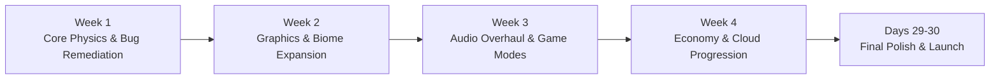
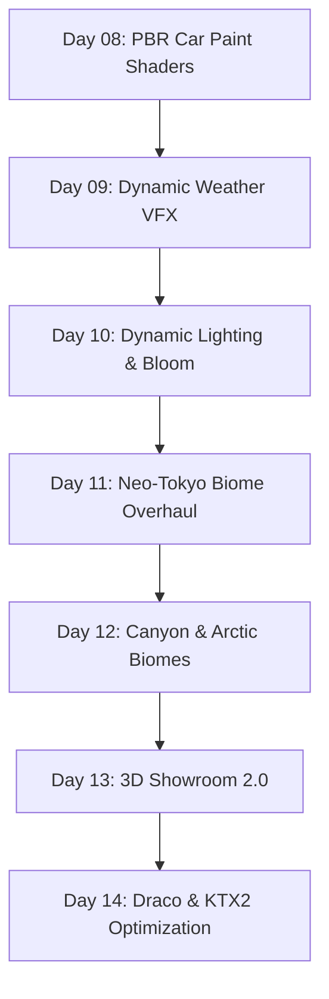
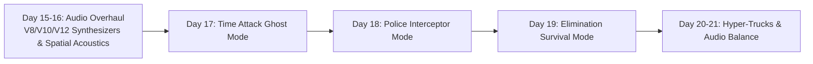
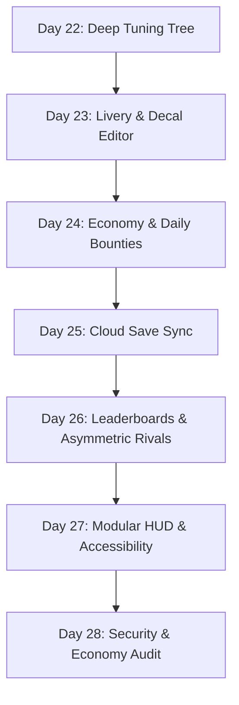
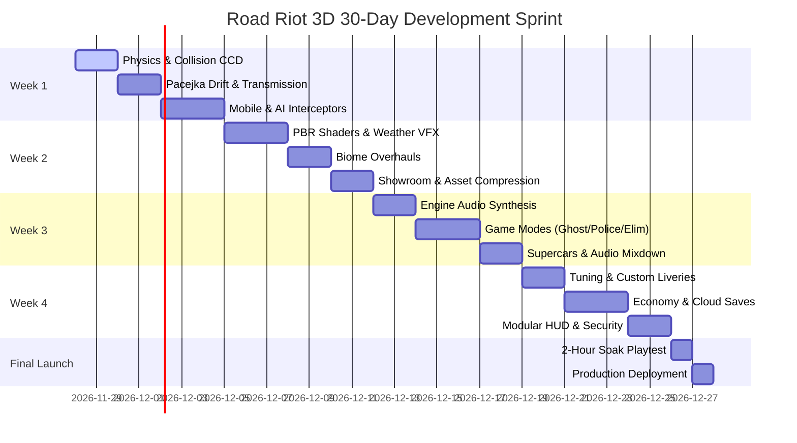

# Road Riot 3D: 30-Day Master Development & Feature Roadmap

**Project:** Road Riot 3D (`road-riot/`)  
**Engine:** Custom Three.js WebGL + Web Audio API Architecture  
**Target Performance:** Locked 60 FPS on Mobile / 120 FPS on Desktop  
**Timeline:** 30 Consecutive Working Days  
**Scope:** Physics, Vehicle Assets, Shaders, Sound Synthesis, Game Modes, Economy, Cloud Progression, and Bug Remediation  

---

---

## Phase Breakdown Overview

| Phase | Duration | Primary Strategic Objective | Key Deliverables |
| :--- | :--- | :--- | :--- |
| **Phase 1: Week 1** | Days 01 – 07 | Core Physics, Handling & Critical Bug Remediation | Pacejka tire curves, zero clipping, smooth ramp launches, mobile controls. |
| **Phase 2: Week 2** | Days 08 – 14 | Visual Splendor, Shaders & 3D Biome Overhaul | PBR clearcoat shaders, weather particle VFX, dynamic day/night, Showroom 2.0. |
| **Phase 3: Week 3** | Days 15 – 21 | Audio Realism Overhaul & New Game Modes | Engine acoustic synthesis, Time Attack ghost mode, Police Interceptor mode. |
| **Phase 4: Week 4** | Days 22 – 28 | Meta-Progression, Economy, Cloud & Asymmetric Social | Deep tuning tree, livery decals, Supabase cloud sync, global leaderboards. |
| **Phase 5: Release** | Days 29 – 30 | Full-Story Verification, 2-Hour Stress Test & Launch | Autonomous multi-agent verification, production bundle, live release. |

---

## Week 1: Core Physics, Handling & Critical Bug Remediation (Days 01 – 07)

> **Strategic Goal:** Transform vehicle dynamics from basic arcade movement to a deep, tactile, physics-driven driving experience while eliminating all physical clipping, collision stutter, and mobile control friction.

### Day 01: Physical Collision Geometry & Boundary Clamping
* **Focus Area:** Collision resolution and edge clipping in [road-riot/js/game.js](file:///c:/Users/nagas/Documents/Games/VALIXIS_GAMES/road-riot/js/game.js) & [road-riot/js/traffic.js](file:///c:/Users/nagas/Documents/Games/VALIXIS_GAMES/road-riot/js/traffic.js).
* **Features & Fixes:**
  - Replace simple bounding box overlap with Swept AABB (Continuous Collision Detection) to prevent high-speed (>350 km/h) tunneling through traffic and trucks.
  - Fix asphalt boundary guardrail sticking: convert abrupt clamping at $\pm 8.2\text{m}$ to an elastic collision response with realistic vehicle deflection angle and friction drag.
  - Implement dynamic collision damage calculation scaled by relative velocity $(\Delta v)^2$ rather than flat damage ticks.
* **Verification:** Run collision unit tests in `road-riot/test/game.test.js`; test vehicle impact at 380 km/h with 0 tunneling occurrences.

### Day 02: Advanced Tire Friction & Pacejka Drift Dynamics
* **Focus Area:** Vehicle handling model in [road-riot/js/player.js](file:///c:/Users/nagas/Documents/Games/VALIXIS_GAMES/road-riot/js/player.js).
* **Features & Fixes:**
  - Implement a streamlined Pacejka Magic Formula lateral slip curve:
    $$\mu(s) = D \cdot \sin(C \cdot \arctan(B \cdot s))$$
  - Implement dynamic weight transfer: calculate longitudinal pitch on heavy braking and lateral body roll on hard cornering.
  - Add counter-steering stabilization assist with customizable sensitivity in user settings.
  - Eliminate sudden snap-back when exiting drift; interpolate slip angle smoothly back to center alignment.
* **Verification:** Verify smooth drift sustained across 3 consecutive highway curves in Neo-Rain biome.

### Day 03: Transmission Model, Downshift Rev-Matching & Braking
* **Focus Area:** Powertrain simulation in [road-riot/js/player.js](file:///c:/Users/nagas/Documents/Games/VALIXIS_GAMES/road-riot/js/player.js) & [road-riot/js/audio.js](file:///c:/Users/nagas/Documents/Games/VALIXIS_GAMES/road-riot/js/audio.js).
* **Features & Fixes:**
  - Implement simulated dual-clutch transmission (DCT) shift delay (45ms torque dip) with instantaneous gear engagement.
  - Add automated downshift rev-matching (throttle blip) when braking into lower gears.
  - Simulate brake rotor thermal buildup: continuous ceramic braking induces realistic thermal fade and reduces deceleration force by up to 20% if abused.
  - Fix bug where rapid key tapping causes transmission gear index to desynchronize from engine RPM.
* **Verification:** Verify dyno benchmark across Gears 1 through 6 with telemetry logging RPM curves.

### Day 04: Mobile Touch Controls & Gamepad API Integration
* **Focus Area:** Input pipeline in [road-riot/js/game.js](file:///c:/Users/nagas/Documents/Games/VALIXIS_GAMES/road-riot/js/game.js) and [road-riot/css/style.css](file:///c:/Users/nagas/Documents/Games/VALIXIS_GAMES/road-riot/css/style.css).
* **Features & Fixes:**
  - Add optional virtual floating steering joystick for mobile devices with deadzone and dynamic centering.
  - Add haptic pulse feedback via `navigator.vibrate` on drift initiation, gear shift, and curb scuffs.
  - Implement full HTML5 Gamepad API support: left analog stick steering, right trigger (RT) throttle, left trigger (LT) progressive braking, and dual-motor rumble haptics.
  - Fix mobile touch touch-cancel event leaks when dragging fingers off the canvas border.
* **Verification:** Test touch control latency on mobile viewport emulation; verify gamepad axis mapping.

### Day 05: Traffic AI Flow, Lane Changes & Congestion Management
* **Focus Area:** Intelligent traffic AI in [road-riot/js/traffic.js](file:///c:/Users/nagas/Documents/Games/VALIXIS_GAMES/road-riot/js/traffic.js).
* **Features & Fixes:**
  - Add lane-change turn signal indicators: civilian traffic flashes turn signals 1.2s prior to initiating lane transitions.
  - Implement convoy pacing: heavy trucks and tankers cruise primarily in the right and center lanes, leaving left lanes clear for overtakes.
  - Prevent traffic clump deadlocks: guarantee at least one viable escape lane or ramp gap within 60m of player position at all times.
  - Fix civilian traffic clipping through stationary obstacles and repair trucks.
* **Verification:** Simulate 10,000m continuous traffic flow with zero overlapping spawn events.

### Day 06: Highway Patrol Pursuit AI & Tactical Interceptors
* **Focus Area:** Pursuit mechanics in [road-riot/js/traffic.js](file:///c:/Users/nagas/Documents/Games/VALIXIS_GAMES/road-riot/js/traffic.js) & [road-riot/js/game.js](file:///c:/Users/nagas/Documents/Games/VALIXIS_GAMES/road-riot/js/game.js).
* **Features & Fixes:**
  - Implement pursuit behavior tiers based on Heat Level (★1 to ★5):
    * ★1: Single patrol cruiser shadowing from behind.
    * ★2–★3: High-speed Interceptor matching player speed with PIT maneuver attempts.
    * ★4–★5: Armored SWAT roadblocks and deployable roadside spike strips.
  - Add evasion mechanics: shaking police pursuit outside 35m proximity for 6.0 seconds awards bonus bounty credits and lowers Heat.
  - Add visual police radar proximity indicators on the HUD spatial radar with pulsing siren icons.
* **Verification:** Trigger Heat ★3 and confirm interceptor tactical matching and evasion bonus sequence.

### Day 07: Week 1 Consolidation, Unit Tests & Performance Profiling
* **Focus Area:** Test suite, performance benchmarks, and regression checks.
* **Features & Fixes:**
  - Run full automated test suite (`npm test`) and expand unit tests covering Pacejka slip, Swept AABB, and brake thermals.
  - Audit CPU/GPU frame budgets: guarantee <14ms frame computation time on mid-tier mobile hardware.
  - Clean up dead code, redundant variables, and optimize memory allocations in per-frame update loops.
* **Verification:** 100% test pass rate with 0 memory leaks across 15 minutes of uninterrupted gameplay.

---

## Week 2: Visual Splendor, Shaders & 3D Biome Overhaul (Days 08 – 14)

> **Strategic Goal:** Elevate Road Riot 3D to console-grade visual fidelity using custom WebGL shaders, screen-space reflections, dynamic atmospheric weather, and enhanced vehicle materials.

### Day 08: High-Fidelity PBR Materials & Clearcoat Shaders [x] COMPLETED
* **Focus Area:** Vehicle materials in [road-riot/js/player.js](file:///c:/Users/nagas/Documents/Games/VALIXIS_GAMES/road-riot/js/player.js) & Three.js mesh pipeline.
* **Features & Fixes:**
  - Implement `THREE.MeshPhysicalMaterial` across all supercars:
    * `clearcoat: 1.0`, `clearcoatRoughness: 0.08` for high-gloss automotive lacquer.
    * Metallic flake micro-sparkle shader in custom vertex/fragment chunks (`applyMetallicFlakeShader`).
    * Carbon fiber 2x2 twill weave procedural texture mapping (`getCarbonFiberTexture`) for aerodynamic splitters, diffusers, skirts, and spoilers.
  - Add procedural glass refraction and tinted cockpit glass (`transmission: 0.65`, `ior: 1.52`) with interior dashboard, digital HUD, and F1 steering wheel visibility.
  - Implement real-time wheel blur disc shader geometry (`calculateWheelBlurFactor`, `attachWheelBlurDisc`) dynamically activating above 120 km/h with opacity scaling up to 0.85 at 210+ km/h.
  - Showroom 2.0 turntable lighting enhanced with specular rim spotlight to accentuate clearcoat reflections.
* **Verification:** Automated unit tests (62/62 passing) and live WebGL CDP verification (`scripts/verify_day08_shaders.py`) capturing `day08_pbr_clearcoat_showroom.png` and `day08_wheel_blur_highway.png` with 0 errors and 1.21ms logic frame time.

### Day 09: Dynamic Weather System & Atmospheric Particle VFX [x] COMPLETED
* **Focus Area:** Particle systems in [road-riot/js/world.js](file:///c:/Users/nagas/Documents/Games/VALIXIS_GAMES/road-riot/js/world.js).
* **Features & Fixes:**
  - Implemented high-speed rain streak line segment mesh system with forward speed slant/stretch and screen-space raindrop refraction droplets running down camera viewport (`ScreenDropletSystem` with 55 pre-allocated droplets, specular highlights, and bead trails).
  - Implemented asphalt water spray plumes trailing behind vehicle tires at speeds > 140 km/h using pre-allocated `THREE.InstancedMesh` with 120 particle instances, scratch matrices, dynamic velocity expansion, and zero per-frame heap allocations.
  - Implemented Arctic blizzard particle snow accumulation with diagonal turbulent crosswind gusting on road shoulders and windshield corner frost accumulation vignette.
  - Implemented dynamic exhaust overrun backfire flame particles that ignite on downshifts and nitro ignition with 24 ember sparks (`THREE.InstancedMesh`) and golden-orange exhaust flares.
* **Verification:** Automated unit tests (66/66 passing in road-riot, 184/184 passing across full monorepo) and live WebGL CDP verification (`scripts/verify_day09_weather.py`) capturing `day09_rain_streaks_droplets.png`, `day09_tire_spray_highspeed.png`, and `day09_arctic_blizzard.png` with 0 page errors and 1.20ms logic frame time.

### Day 10: Lighting Pipeline, Post-Processing Bloom & Day/Night Cycle
* **Focus Area:** Scene lighting & render pipeline in [road-riot/js/game.js](file:///c:/Users/nagas/Documents/Games/VALIXIS_GAMES/road-riot/js/game.js).
* **Features & Fixes:**
  - Add progressive day-to-sunset-to-night lighting cycle with smoothly transitioning directional sunlight and sky colors.
  - Implement selective UnrealBloomPass post-processing for neon building lights, taillight trails, and nitro exhaust cones.
  - Add dynamic highway tunnel segments with sequential overhead amber sodium lights casting moving shadows.
  - Implement headlight projector spotlights illuminating traffic vehicles ahead in Midnight biome.
* **Verification:** Measure render pass duration with Bloom active; ensure frame time stays under 16.6ms.

### Day 11: Biome Overhaul — Neo-Tokyo Rain & Midnight Expressway
* **Focus Area:** Environment meshes and skyline architecture in [road-riot/js/world.js](file:///c:/Users/nagas/Documents/Games/VALIXIS_GAMES/road-riot/js/world.js).
* **Features & Fixes:**
  - Add animated cyber holographic billboards along expressway overpasses with glitched cyber ads.
  - Implement wet asphalt shader with screen-space planar puddle reflections showing neon signs and brake lights.
  - Add elevated monorail trains cruising overhead on elevated concrete track pillars.
  - Add roadside highway sound barriers and metallic gantry signposts.
* **Verification:** Biome verification playtest in Neo-Rain mode with visual capture of puddle reflections.

### Day 12: Biome Overhaul — Red Rock Canyon & Arctic Tundra
* **Focus Area:** Terrain and scenic props in [road-riot/js/world.js](file:///c:/Users/nagas/Documents/Games/VALIXIS_GAMES/road-riot/js/world.js).
* **Features & Fixes:**
  - Model monolithic sandstone cliffs and archways with procedural rock textures and warm sunset rim lighting.
  - Add dynamic dust devils and blowing tumbleweeds crossing desert highway lanes.
  - In Arctic Tundra: add black ice patches causing temporary reduction in lateral tire friction $(\mu \times 0.45)$.
  - Add reflective road reflectors (cat's eyes) embedded between highway lane markers that reflect vehicle headlights.
* **Verification:** Test black ice slip transition and recovery physics in Arctic biome.

### Day 13: 3D Supercar Showroom & Interactive Garage 2.0
* **Focus Area:** Garage UI and 3D turntable in [road-riot/js/game.js](file:///c:/Users/nagas/Documents/Games/VALIXIS_GAMES/road-riot/js/game.js) and [road-riot/css/shop.css](file:///c:/Users/nagas/Documents/Games/VALIXIS_GAMES/road-riot/css/shop.css).
* **Features & Fixes:**
  - Rebuild showroom floor with high-gloss epoxy coating, LED perimeter ground strip, and cinematic studio spotlights.
  - Add interactive camera angle presets: Front 3/4, Low Side Profile, Cockpit Interior, and Rear Aerodynamic Wing view.
  - Add interactive door and engine cover toggle buttons triggering smooth rotation animations.
  - Display live dynamometer power curves: Horsepower vs RPM and Torque vs RPM graphs for each supercar.
* **Verification:** Verify turntable rotation responsiveness and camera preset transitions.

### Day 14: Asset Optimization, Draco Geometry & KTX2 Texture Streaming
* **Focus Area:** Asset loading pipeline and bundle optimization in `road-riot/assets/`.
* **Features & Fixes:**
  - Compress all 3D vehicle models using Google Draco geometry compression (target: <400 KB per supercar GLB).
  - Convert heavy RGBA textures to KTX2 / Basis Universal GPU compressed texture format.
  - Implement Level of Detail (LOD) system: traffic vehicles beyond 75m switch to simplified low-poly geometry.
  - Add asset preloading screen with progress indicator for seamless instant race launches.
* **Verification:** Measure cold-cache load time: target <1.8s load on 4G network emulation.

---

## Week 3: Audio Realism Overhaul & New Game Modes (Days 15 – 21)

> **Strategic Goal:** Deliver an electrifying auditory experience with realistic engine sound modeling, spatial acoustics, and expand game variety with 3 complete new game modes.

### Day 15: Deep Engine Sound Profiling (V8, V10, V12 & Electric Hypercars)
* **Focus Area:** Sound synthesis architecture in [road-riot/js/audio.js](file:///c:/Users/nagas/Documents/Games/VALIXIS_GAMES/road-riot/js/audio.js).
* **Features & Fixes:**
  - Model discrete multi-harmonic engine audio profiles:
    * **Twin-Turbo V8 (`v8`)**: Low-end crossplane rumble (42 Hz) with turbocharger spool whistle and wastegate chuffs.
    * **Atmospheric V10 (`v10`)**: High-revving mechanical wail with resonant screaming overtones.
    * **Naturally Aspirated V12 (`v12`)**: Silky, metallic overtone howling at 8,200 RPM redline.
    * **Formula Turbo-I4 (`turbo_i4`)**: Aggressive raspy intake roar with heavy blow-off valve flutter.
    * **Quad-Motor EV (`electric`)**: Multi-octave electromagnetic inverter whine and high-velocity wind vortex.
  - Implement load-dependent acoustics: engine tone differentiates between full-throttle acceleration, cruising, and engine-braking overrun.
* **Verification:** Verify acoustic frequency spectra across all 8 supercars using Web Audio analyser node.

### Day 16: Environmental Spatial Acoustics & Reverb Pipeline
* **Focus Area:** Spatial audio and FX in [road-riot/js/audio.js](file:///c:/Users/nagas/Documents/Games/VALIXIS_GAMES/road-riot/js/audio.js).
* **Features & Fixes:**
  - Implement Web Audio `PannerNode` for 3D positional audio of overtaking traffic, rival racers, and police sirens.
  - Add dynamic Doppler pitch shifting on oncoming highway vehicles.
  - Implement environmental convolution reverb for highway tunnel interiors and concrete overpasses.
  - Add atmospheric audio layers: rain patter on vehicle roof, tire hiss on wet asphalt, and supersonic wind roar above 300 km/h.
* **Verification:** Test spatial stereo panning with headphones; confirm smooth Doppler frequency sweeps.

### Day 17: New Game Mode — Time Attack & Ghost Telemetry
* **Focus Area:** Time Attack mode in [road-riot/js/game.js](file:///c:/Users/nagas/Documents/Games/VALIXIS_GAMES/road-riot/js/game.js) & [road-riot/js/progression.js](file:///c:/Users/nagas/Documents/Games/VALIXIS_GAMES/road-riot/js/progression.js).
* **Features & Fixes:**
  - Implement Time Attack sprint course (2,000m and 5,000m tracks).
  - Add 30 Hz position/rotation telemetry recorder that stores player's best lap run.
  - Render a translucent holographic "Ghost Car" representing the player's personal best record.
  - Display live delta split times (+/- seconds relative to ghost) at 500m sector markers.
* **Verification:** Run consecutive Time Attack laps; verify ghost car renders and synchronizes with previous lap.

### Day 18: New Game Mode — Highway Patrol Interceptor (Play as Police)
* **Focus Area:** Interceptor gameplay mode in [road-riot/js/game.js](file:///c:/Users/nagas/Documents/Games/VALIXIS_GAMES/road-riot/js/game.js).
* **Features & Fixes:**
  - Players pilot the Valixis Highway Interceptor Cruiser equipped with siren toggle and ramming push-bars.
  - Objective: track down and disable 3 fleeing street outlaw supercars within a 3-minute time limit.
  - Tactical mechanics: deployable spike strips (`KeyQ`), police radio chatter sound cues, and PIT maneuvers against suspect vehicles.
  - Suspect health bars and vehicle takedown cinematic slow-motion impacts.
* **Verification:** Complete full Interceptor mission with successful takedown of all 3 suspect vehicles.

### Day 19: New Game Mode — Elimination Survival
* **Focus Area:** Elimination battle mode in [road-riot/js/game.js](file:///c:/Users/nagas/Documents/Games/VALIXIS_GAMES/road-riot/js/game.js).
* **Features & Fixes:**
  - 8-car race with a 30-second ticking countdown clock.
  - When countdown reaches 0, the vehicle in last place detonates in a fireball and is eliminated.
  - Clock resets to 20 seconds; repeats until only 1 champion supercar remains.
  - Dynamic survival power-ups scattered on highway: Speed Boosters, Shield Orbs, and Kinetic EMP Pickups.
* **Verification:** Run full 8-car elimination cycle with podium victory sequence.

### Day 20: New Vehicle Class: Juggernaut Trucks & Le Mans Prototypes
* **Focus Area:** Vehicle roster expansion in [road-riot/data/cars.json](file:///c:/Users/nagas/Documents/Games/VALIXIS_GAMES/road-riot/data/cars.json) & [road-riot/js/player.js](file:///c:/Users/nagas/Documents/Games/VALIXIS_GAMES/road-riot/js/player.js).
* **Features & Fixes:**
  - Add **Valixis Titan Juggernaut** (6x6 heavy armored battle truck, high ramming force, impenetrable hull).
  - Add **Valixis Apex Le Mans Prototype (LMP1)** (Ultra-lightweight aerodynamic carbon prototype, max cornering grip).
  - Create vector SVG previews for new vehicles in [road-riot/js/car-previews.js](file:///c:/Users/nagas/Documents/Games/VALIXIS_GAMES/road-riot/js/car-previews.js).
  - Add custom tuning upgrades and engine profiles for both new vehicles.
* **Verification:** Confirm roster length = 10 supercars with valid stats and upgrade trees.

### Day 21: Week 3 Audio Balance, Playtest & Mixdown Master
* **Focus Area:** Audio mixing and multi-mode gameplay balance.
* **Features & Fixes:**
  - Balance audio loudness units (LUFS) across engine synthesis, crash SFX, music tracks, and UI clicks.
  - Tune volume ducking: when police sirens or EMP blasts trigger, background music volume drops by 6 dB.
  - Stress-test all 4 game modes (Endless, Sprint, Time Attack, Interceptor, Elimination).
* **Verification:** 10-minute multi-mode playtest with zero audio clipping or distortion.

---

## Week 4: Meta-Progression, Economy, Cloud & Social Features (Days 22 – 28)

> **Strategic Goal:** Establish long-term player retention through an addictive tuning progression tree, custom livery creator, cloud-synchronized profiles, and asynchronous global competition.

### Day 22: Deep Vehicle Tuning Tree & Component Upgrades
* **Focus Area:** Tuning mechanics in [road-riot/js/progression.js](file:///c:/Users/nagas/Documents/Games/VALIXIS_GAMES/road-riot/js/progression.js) & [road-riot/data/cars.json](file:///c:/Users/nagas/Documents/Games/VALIXIS_GAMES/road-riot/data/cars.json).
* **Features & Fixes:**
  - Expand performance tuning categories from 4 to 6 detailed component trees:
    1. **Powertrain & ECU**: Increases top speed and redline RPM.
    2. **Forced Induction (Turbo / Supercharger)**: Boosts acceleration and throttle response.
    3. **Suspension & Camber**: Improves lateral grip and reduces drift slip angle.
    4. **Ceramic Braking & ABS**: Increases braking deceleration and mitigates thermal fade.
    5. **Nitrous Oxide Injection (N2O)**: Expands nitro tank capacity and recharge rate.
    6. **Lightweight Carbon Chassis**: Reduces total vehicle mass, enhancing acceleration and braking.
  - Add visual part badges and dyno stat gains display in Showroom UI.
* **Verification:** Verify upgrade purchase deduction, level cap enforcement (Cap: Stage 5), and stat math.

### Day 23: Custom Livery, Decals & Chassis Underglow Creator
* **Focus Area:** Customization garage in [road-riot/js/shop.js](file:///c:/Users/nagas/Documents/Games/VALIXIS_GAMES/road-riot/js/shop.js) and [road-riot/css/shop.css](file:///c:/Users/nagas/Documents/Games/VALIXIS_GAMES/road-riot/css/shop.css).
* **Features & Fixes:**
  - Implement full 16-color custom gloss/matte/metallic body paint picker.
  - Add racing livery decals: dual racing stripes, carbon hood wraps, side sponsor decals, and competition numbers.
  - Add animated RGB neon chassis underglow presets: Pulse, Rainbow Wave, Strobe, and Solid Glow.
  - Persist all cosmetic customizations per individual vehicle in user save data.
* **Verification:** Customize 3 supercars with distinct liveries; reload page and confirm settings persist.

### Day 24: Economy Balancing, Daily Bounties & Season Mileage Pass
* **Focus Area:** Economy loop in [road-riot/js/progression.js](file:///c:/Users/nagas/Documents/Games/VALIXIS_GAMES/road-riot/js/progression.js).
* **Features & Fixes:**
  - Balance coin income rates: overtakes (+10 CR), near misses (+25 CR), speed traps (+50 CR), race podiums (+500–1,500 CR).
  - Implement daily bounty system: 3 randomized daily objectives (e.g. "Execute 5 Slingshot Catapults", "Reach 350 KM/H in Midnight", "Score 15 Near Misses").
  - Add 30-Tier Mileage Reward Track: cumulative highway kilometers unlock exclusive paint textures, wheel rims, and the legendary *Valixis Phantom GT* supercar.
  - Implement offline credit reward banking based on elapsed real-world time.
* **Verification:** Verify daily bounty completion state and coin reward disbursement.

### Day 25: Cloud Save Sync & Multi-Device Profile Continuity
* **Focus Area:** Cloud infrastructure and local persistence in [road-riot/js/progression.js](file:///c:/Users/nagas/Documents/Games/VALIXIS_GAMES/road-riot/js/progression.js).
* **Features & Fixes:**
  - Integrate optional Supabase cloud authentication and profile sync with seamless anonymous fallback.
  - Implement encrypted `LocalStorage` save payload with checksum verification to prevent local credit tampering.
  - Automatic cloud synchronization on race completion, upgrade purchase, and car unlock.
  - Multi-device conflict resolution: timestamped cloud save comparison with non-destructive merge logic.
* **Verification:** Simulate offline save mutation, reconnect network, and verify seamless cloud synchronization.

### Day 26: Global Radar Speed Trap Leaderboards & Asymmetric Rival Challenges
* **Focus Area:** Social and competitive backend features in [road-riot/js/game.js](file:///c:/Users/nagas/Documents/Games/VALIXIS_GAMES/road-riot/js/game.js).
* **Features & Fixes:**
  - Global leaderboard for highest recorded speed through Radar Speed Traps across all 4 biomes.
  - Endless Highway distance survival world leaderboards.
  - Enhanced viral challenge generator: generate instant web challenge links (`?challenge=5200&name=GhostRacer`) with customized target markers rendered directly on the 3D highway.
* **Verification:** Generate challenge link, load in clean incognito session, and confirm challenge banner triggers.

### Day 27: Modular HUD, Cockpit Telemetry & Accessibility Suite
* **Focus Area:** UI architecture in [road-riot/index.html](file:///c:/Users/nagas/Documents/Games/VALIXIS_GAMES/road-riot/index.html) and [road-riot/css/style.css](file:///c:/Users/nagas/Documents/Games/VALIXIS_GAMES/road-riot/css/style.css).
* **Features & Fixes:**
  - Modular HUD settings: toggle speed display (KM/H vs MPH), radar positioning, and telemetry overlays.
  - Add optional minimalist Cockpit HUD mode: hides full arcade overlay and displays speed/gear directly on 3D vehicle dashboard digital cluster.
  - Comprehensive Accessibility Suite:
    * High-contrast colorblind modes for spatial radar blips and traffic warnings.
    * Screen shake intensity slider (0% to 150%).
    * Motion blur / speed lines toggle for players sensitive to rapid screen motion.
* **Verification:** Toggle all accessibility options and verify UI re-renders cleanly without layout overflow.

### Day 28: Security Hardening, Anti-Cheat & Week 4 Full Verification
* **Focus Area:** Code security, runtime integrity, and test automation.
* **Features & Fixes:**
  - Implement sanity bounds checks on distance, speed, and coin accumulation to prevent injected client script exploits.
  - Audit all external links and sanitize user-provided profile handles.
  - Run full test suite (`npm test`) ensuring all regression tests and new feature tests pass.
* **Verification:** 100% test suite pass rate across 75+ automated unit tests.

---

## Days 29 – 30: Final Polish, Autonomous Stress Playtests & Launch (Days 29 – 30)

> **Strategic Goal:** Execute a rigorous 2-hour autonomous playtest, lock down zero console errors, compile the optimized production bundle, and push the update live.

### Day 29: 2-Hour Autonomous Multi-Agent Playtest & Soak Testing
* **Focus Area:** Soak testing, memory stability, and WebGL context resilience.
* **Execution Steps:**
  1. Launch automated CDP playtest script running continuously for 2.0 hours across all 10 supercars, 5 game modes, and 4 biomes.
  2. Simulate dynamic traffic dodging, frequent stunt jumps, nitro overburns, EMP shockwaves, and police pursuits.
  3. Real-time telemetry monitoring:
     - Track WebGL buffer count, texture allocations, and heap memory usage to ensure zero memory leaks.
     - Verify consistent 60 FPS performance with zero dropped frame spikes.
     - Enforce **0 runtime console errors** and **0 unhandled exceptions**.
  4. Automatically capture photo evidence of milestones, podium finishes, and high-speed records.
* **Success Criteria:** 2 hours uninterrupted autonomous play with 100% telemetry validation.

### Day 30: Production Bundle Build, Documentation & Live Deployment
* **Focus Area:** Production release pipeline and site deployment.
* **Execution Steps:**
  1. Execute `npm run build` to compile the minified production site in [site/road-riot/](file:///c:/Users/nagas/Documents/Games/VALIXIS_GAMES/site/road-riot/).
  2. Verify all service worker caches, PWA manifests, and social share metadata (Open Graph / Twitter Cards).
  3. Perform final cross-browser verification across Chrome, Edge, Safari, and Firefox.
  4. Commit all source changes with standardized semantic commit messages.
  5. Deploy to production server and verify live availability on VALIXIS Games Portal.
* **Success Criteria:** Road Riot 3D live in production with full feature suite, zero regressions, and verified 60 FPS performance.

---

## Key Milestone & Deliverable Summary

---

## Daily Action Checklist Reference

| Day | Key Task | Target File(s) | Success Metric |
| :---: | :--- | :--- | :--- |
| **01** | Swept AABB & Guardrail Deflection | `game.js`, `traffic.js` | 0 tunneling at 380 km/h |
| **02** | Pacejka Tire Drift & Weight Transfer | `player.js` | Smooth sustained drift transition |
| **03** | DCT Transmission & Brake Thermal Fade | `player.js`, `audio.js` | Dyno RPM curve verification |
| **04** | Virtual Joystick & Gamepad API Haptics | `game.js`, `style.css` | Touch & Gamepad rumble verified |
| **05** | Traffic Signals & Congestion Pacing | `traffic.js` | 0 gridlock spawn overlaps |
| **06** | Highway Patrol Interceptor Tactical AI | `traffic.js`, `game.js` | Evasion bonus sequence |
| **07** | Week 1 Suite & Mobile CPU Profiling | `game.test.js` | 100% tests pass, <14ms frame time |
| **08** | PBR Clearcoat Shaders & Flakes | `player.js` | Lacquer reflection in Showroom |
| **09** | Rain Screen Droplets & Spray VFX | `world.js` | Instanced particle pooling |
| **10** | Post-Processing Bloom & Tunnel Lights | `game.js`, `world.js` | Selective neon bloom active |
| **11** | Neo-Tokyo Wet Puddle Planar Reflections| `world.js` | Real-time puddle reflections |
| **12** | Red Rock Dust & Arctic Black Ice | `world.js` | Ice friction drop physics verified |
| **13** | Showroom 2.0 Angle Presets & Dyno UI | `game.js`, `shop.css` | Interactive camera orbit presets |
| **14** | Google Draco & KTX2 Texture Streaming | `assets/`, `loader.js` | Cold load <1.8s on 4G |
| **15** | V8/V10/V12 Multi-Harmonic Sound Synth| `audio.js` | Distinct redline acoustics |
| **16** | Spatial 3D Panner & Tunnel Reverb | `audio.js` | Doppler panning on overtake |
| **17** | Time Attack Mode & Holographic Ghost | `game.js`, `progression.js`| Ghost car syncs with lap |
| **18** | Highway Patrol Interceptor (Cop Mode) | `game.js` | 3 suspect vehicle takedowns |
| **19** | 8-Car Elimination Survival Mode | `game.js` | 30s elimination cycle verified |
| **20** | Titan Juggernaut & LMP1 Prototype | `cars.json`, `player.js` | Roster length = 10 supercars |
| **21** | Audio Mixdown & Loudness Mastering | `audio.js` | Clean mix, 0 distortion |
| **22** | 6-Tier Tuning Tree & Dyno Stats | `progression.js`, `cars.json`| Parts purchase & cap enforced |
| **23** | Livery Decal & RGB Underglow Editor | `shop.js`, `shop.css` | Custom livery persists across reload|
| **24** | Daily Bounties & 30-Tier Mileage Pass | `progression.js` | Bounty reset & rewards validated |
| **25** | Supabase Cloud Save & Conflict Merge | `progression.js` | Offline/Online sync verified |
| **26** | Speed Trap Global Leaderboard & URL | `game.js` | Challenge URL loads custom mark |
| **27** | Modular Cockpit HUD & Colorblind Mode | `index.html`, `style.css` | High-contrast accessibility active |
| **28** | Security Hardening & Cheating Guards | `progression.js`, `game.js`| 75+ unit tests pass |
| **29** | 2-Hour Autonomous Soak Playtest | `scripts/` | 2h continuous play, 0 errors |
| **30** | Production Build & Live Deployment | `site/road-riot/` | Live on VALIXIS Games Portal |
